<!-- brief:start -->

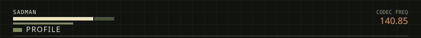
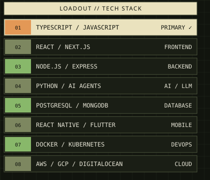
<a href="https://www.sadmanyasar.site">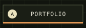</a><a href="https://github.com/SadmanYasar">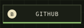</a><a href="https://www.linkedin.com/in/sadman-yasar-sayem">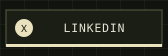</a><a href="https://www.sadmanyasar.site">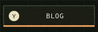</a><a href="mailto:sadmanyasarsayem@gmail.com">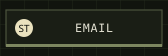</a>
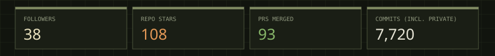
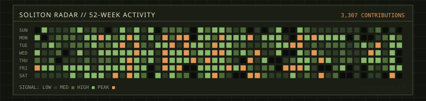
<a href="https://github.com/SadmanYasar/arch-review-agent">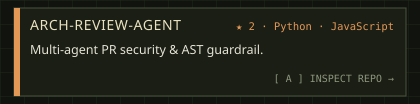</a><a href="https://github.com/SadmanYasar/3d-spritesheet-studio">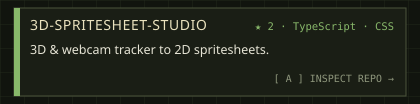</a>
<a href="https://github.com/SadmanYasar/agent-in-go">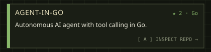</a><a href="https://github.com/SadmanYasar/3D-cat-art-museum">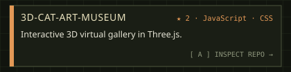</a>
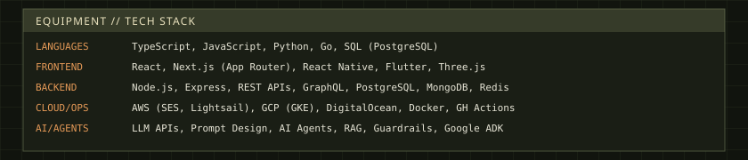
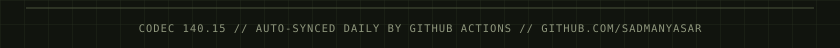

<!-- brief:end -->
